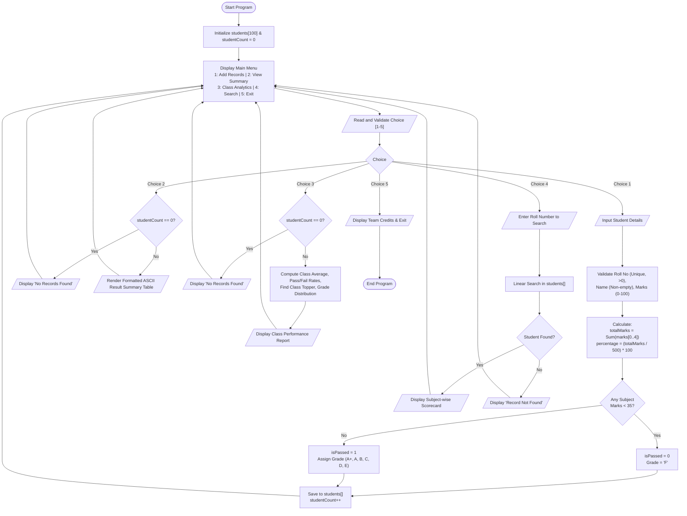

# Student Result and Grade Analyzer
> **C Programming Mini Hackathon Submission**  
> A menu-driven student performance evaluation, individual subject pass-verification, and class analytics system implemented in standard C.

---

## 👥 Team Details

| Attribute | Details |
| :--- | :--- |
| **Batch** | `Batch - 19` |
| **Team Number / Name** | `APEX FOUR` |
| **Project Repository** | `Batch19_TeamAPEXFOUR_StudentResultAnalyzer` |
| **Team Members** | 1. **Daksh** (Lead Architect & Core Implementation)<br>2. **Shriman Nautiyal** (Algorithms, Grading Logic & Validation)<br>3. **Shivam Rawat** (Testing, Verification & Documentation) |

---

## 📌 Problem Statement

In academic institutions, calculating student results, assigning letter grades, and identifying class-wide metrics manually is time-consuming and prone to computational errors. Furthermore, naive percentage calculators often mask severe academic deficiencies: a student scoring very high marks in four subjects but failing a core subject might erroneously be marked as passed based on overall average.

**The Objective:**  
Develop a robust, user-friendly, menu-driven C program to:
1. Record student credentials and marks across 5 distinct academic subjects.
2. Calculate total marks, overall percentage, and assign standard letter grades (`A+`, `A`, `B`, `C`, `D`, `E`, `F`).
3. Enforce a **mandatory minimum passing threshold of 35 marks in EACH subject**. If any single subject score falls below 35, the student is strictly classified as **FAIL** with grade **`F`**, regardless of total score or overall percentage.
4. Render a formatted **Student-wise Result Summary** table.
5. Generate a **Class Performance & Analytics Report** showing total enrollment, pass/fail counts, pass percentage, overall class average, topper details, and grade distribution.
6. Provide resilient **input validation** against invalid menu options, buffer overflow, alphabetical inputs, duplicate roll numbers, negative values, and out-of-range marks (`0–100`).

---

## 🚀 Key Features

- **Menu-Driven Workflow:** Modular 5-option interactive console menu.
- **Strict Subject-Wise Pass Evaluation:** Enforces `passing marks >= 35` for all 5 subjects (Mathematics, Physics, Chemistry, Computer Science, and English).
- **Comprehensive Letter Grading:**
  - `A+` : Percentage $\ge 90\%$
  - `A`  : $80\% \le \text{Percentage} < 90\%$
  - `B`  : $70\% \le \text{Percentage} < 80\%$
  - `C`  : $60\% \le \text{Percentage} < 70\%$
  - `D`  : $50\% \le \text{Percentage} < 60\%$
  - `E`  : $35\% \le \text{Percentage} < 50\%$
  - `F`  : $\text{Percentage} < 35\%$ OR failed in any individual subject.
- **Student-Wise ASCII Table:** High-clarity aligned table displaying roll numbers, truncated names, subject breakdown, totals, percentages, grades, and statuses.
- **Class Intelligence & Analytics:**
  - Class Average Percentage.
  - Overall Pass / Fail count and percentage.
  - Automatic Class Topper detection (highest percentage among passed candidates).
  - Complete 7-tier grade distribution breakdown.
- **Roll Number Lookup / Search:** Instantly retrieve an individual student scorecard with per-subject pass/fail breakdown.
- **Bulletproof Input Validation:**
  - Safe line-based reading (`fgets`) preventing `scanf` buffer hanging.
  - Rejection of non-numeric characters, empty names, negative roll numbers, and marks outside `0.0 – 100.0`.
  - Uniqueness checking for roll numbers.
  - Graceful handling of empty-state operations (viewing reports before adding data).

---

## 🧠 Fundamental C Concepts Used

| Concept | Implementation in Project |
| :--- | :--- |
| **`struct`** | `Student` structure encapsulating roll number, name string, 5-element float marks array, total marks, percentage, grade string, and pass flag. |
| **Arrays (1D)** | `marks[5]` array within `Student`, `students[MAX_STUDENTS]` array for class storage, and subject name array pointers. |
| **Strings** | String manipulation via `fgets()`, `sscanf()`, `strcpy()`, `strncpy()`, `strlen()`, `strcspn()`, and `strcmp()`. |
| **Pointers** | Efficient pass-by-reference in functions (`Student *s`, `const Student *students`, `int *studentCount`) to modify and access records without high stack overhead. |
| **Functions** | 11 clean, modular, single-responsibility functions with clear prototypes. |
| **Loops** | `while` loops for input retry mechanisms and main application lifecycle; `for` loops for record traversal and statistical aggregations. |
| **`switch-case`** | Main menu dispatcher routing user actions cleanly. |
| **`if-else` Chains** | Boundary checks, subject-level failure validation, and letter grade classification. |

---

## 📊 Flowchart & Algorithm

### Mermaid Flowchart



### Visual Diagram
A high-resolution standalone visual flowchart diagram has been rendered into:  
`screenshots/flowchart.png`

### Algorithm / Pseudocode
```text
1. START
2. Declare struct Student with attributes (rollNo, name, marks[5], totalMarks, percentage, grade, isPassed).
3. Initialize students[MAX_STUDENTS] array and studentCount = 0.
4. REPEAT:
     Display Main Menu (1: Add, 2: Summary, 3: Analytics, 4: Search, 5: Exit).
     Safely read user menu choice using fgets() and sscanf().
     SWITCH choice:
       CASE 1:
         Input number of students to add (N).
         FOR each student i from 1 to N:
           DO:
             Read Roll Number.
           WHILE (Roll Number <= 0 OR Roll Number already exists in database).
           Read non-empty Student Name.
           FOR each subject j from 0 to 4:
             DO:
               Read marks[j].
             WHILE (marks[j] < 0.0 OR marks[j] > 100.0).
           totalMarks = sum of marks[0..4].
           percentage = (totalMarks / 500.0) * 100.0.
           isPassed = 1.
           FOR each subject j from 0 to 4:
             IF marks[j] < 35.0 THEN:
               isPassed = 0.
           IF isPassed == 0 THEN:
             grade = "F".
           ELSE IF percentage >= 90.0 THEN grade = "A+".
           ELSE IF percentage >= 80.0 THEN grade = "A".
           ELSE IF percentage >= 70.0 THEN grade = "B".
           ELSE IF percentage >= 60.0 THEN grade = "C".
           ELSE IF percentage >= 50.0 THEN grade = "D".
           ELSE IF percentage >= 35.0 THEN grade = "E".
           ELSE grade = "F".
           Append record to students[studentCount].
           studentCount = studentCount + 1.
       CASE 2:
         IF studentCount == 0 THEN display empty database warning.
         ELSE print ASCII formatted summary table with headers.
       CASE 3:
         IF studentCount == 0 THEN display empty database warning.
         ELSE:
           Compute passedCount, failedCount, sumPercentage.
           Find student with max percentage among passed candidates (Class Topper).
           Compute grade distribution counters (A+, A, B, C, D, E, F).
           Print formatted Class Analytics Report.
       CASE 4:
         Read search Roll Number.
         Perform linear search on students array.
         IF found, display detailed scorecard; ELSE display error.
       CASE 5:
         Display closing message and terminate loop.
5. STOP
```

---

## 🛠️ Step-by-Step Compilation & Execution Guide

### Prerequisites
- GCC Compiler (MinGW / GCC on Windows or Linux).
- Terminal (PowerShell / Command Prompt / Bash).

### 1. Compile the Program
Compile with standard strict compiler warning flags (`-Wall -Wextra`):
```bash
gcc -Wall -Wextra result_analyzer.c -o result_analyzer
```
*(The compilation finishes with **zero errors and zero warnings**).*

### 2. Run the Executable
**On Windows:**
```powershell
.\result_analyzer.exe
```

**On Linux / macOS:**
```bash
./result_analyzer
```

### 3. Automated Regression Testing (Optional)
To run automated input tests through stdin redirection:
```powershell
Get-Content test_input.txt | .\result_analyzer.exe
```

---

## 🧪 Comprehensive Test Suite & Actual Verification Results

The table below documents empirical test cases executed during Task 2 testing:

| Test ID | Test Category | Input Data | Expected Output | Actual Output (Observed) | Verdict |
| :---: | :--- | :--- | :--- | :--- | :---: |
| **TC-01** | **Normal Pass & Boundary 100** | Roll: `101`<br>Name: `Daksh Sharma`<br>Marks: `95, 98, 100, 92, 90` | Total: `475.0`<br>Percentage: `95.00%`<br>Grade: `A+`<br>Status: `PASS` | Total: `475.0`<br>Percentage: `95.00%`<br>Grade: `A+`<br>Status: `PASS` (Class Topper) | **PASS** |
| **TC-02** | **Subject Fail with High Total** | Roll: `102`<br>Name: `Shriman Nautiyal`<br>Marks: `88, 92, 28, 85, 90` | Total: `383.0` (76.60%)<br>Chemistry: `28` (< 35)<br>Grade: `F`<br>Status: `FAIL` | Total: `383.0`<br>Percentage: `76.60%`<br>Chemistry: `28.0` [FAIL (< 35)]<br>Grade: `F`, Status: `FAIL` | **PASS** |
| **TC-03** | **Pass Threshold Boundary (35)** | Roll: `103`<br>Name: `Shivam Rawat`<br>Marks: `35, 40, 35, 50, 45` | Total: `205.0`<br>Percentage: `41.00%`<br>All $\ge 35$<br>Grade: `E`<br>Status: `PASS` | Total: `205.0`<br>Percentage: `41.00%`<br>Grade: `E`<br>Status: `PASS` | **PASS** |
| **TC-04** | **Minimum Score Boundary (0)** | Roll: `104`<br>Name: `Aarav Patel`<br>Marks: `75, 80, 0, 70, 65` | Total: `290.0` (58.00%)<br>Chemistry: `0` (< 35)<br>Grade: `F`<br>Status: `FAIL` | Total: `290.0`<br>Percentage: `58.00%`<br>Chemistry: `0.0` [FAIL (< 35)]<br>Grade: `F`, Status: `FAIL` | **PASS** |
| **TC-05** | **Negative & Non-Numeric Marks** | Marks: `-5`, `105`, `xyz` | Reject, clear stdin buffer, and re-prompt user | Printed: `[ERROR] Marks must be between 0.0 and 100.0` and `[ERROR] Invalid numeric input!`. Re-prompted successfully without infinite loop. | **PASS** |
| **TC-06** | **Negative & Duplicate Roll No** | Roll: `-10`, `abc`, duplicate `101` | Reject negative & duplicate with descriptive alert | Printed: `[ERROR] Roll number must be a positive integer.` and `[ERROR] Roll Number 101 already exists!`. Re-prompted. | **PASS** |
| **TC-07** | **Zero-Record Empty State** | Select Options `2`, `3`, `4` before adding students | Prevent segmentation fault; display clear warning | Cleanly displayed: `[!] No student records found. Please add student records using Menu Option 1 first.` | **PASS** |

---

## 📁 Repository Structure

```text
Batch19_TeamAPEXFOUR_StudentResultAnalyzer/
│
├── result_analyzer.c           # Source code in standard C (menu-driven, robust validation)
├── README.md                   # Comprehensive documentation and verification report
├── presentation.pptx           # Professional 7-slide widescreen presentation (python-pptx)
├── presentation_content.md     # Markdown transcript of the presentation slides
├── generate_flowchart.py       # Flowchart generator script using Pillow
├── build_presentation.py       # Automated PowerPoint generation script
├── test_input.txt              # Standard automated regression test input suite
├── .gitignore                  # Git ignore rules for compiled binaries (*.exe, *.out, *.o)
│
└── screenshots/
    ├── sample_output.txt       # Complete verified terminal run output log
    └── flowchart.png           # High-resolution visual logic flowchart diagram
```

---

## 🏆 Mini Hackathon Submission Checklist

- [x] Full compliance with Problem Statement ("Student Result and Grade Analyzer").
- [x] Batch (`Batch - 19`) & Team (`APEX FOUR`) accurately cited.
- [x] All 3 team members credited: **Daksh**, **Shriman Nautiyal**, **Shivam Rawat**.
- [x] Code compiles with `gcc -Wall -Wextra` with **0 errors and 0 warnings**.
- [x] Minimum passing mark of 35 in EACH subject enforced.
- [x] Robust buffer-safe input validation implemented.
- [x] Sample terminal run output saved in `screenshots/sample_output.txt`.
- [x] Flowchart generated and saved in `screenshots/flowchart.png`.
- [x] 7-slide professional presentation generated in `presentation.pptx`.
- [x] Repository configured with `.gitignore` and initialized with clean git commits.
